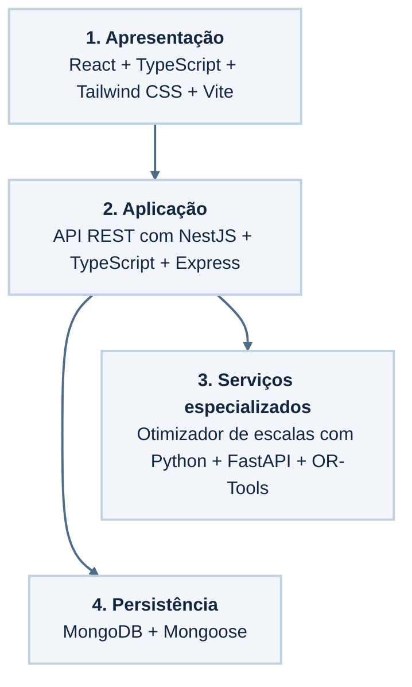

# Stack do projeto — NurseFlow

O NurseFlow é um sistema de gestão de escalas de plantão. Este documento resume as tecnologias do projeto e o papel de cada uma na arquitetura.

## 1. Visão geral

| Camada | Tecnologias |
| --- | --- |
| Apresentação | React, TypeScript, Tailwind CSS e Vite |
| Aplicação | NestJS com Express e API REST |
| Serviços especializados | Python, FastAPI e OR-Tools |
| Persistência | MongoDB e Mongoose |

**Infraestrutura de apoio** — Docker, Docker Compose e Nginx.

## 2. Arquitetura

O front-end acessa a API por HTTP com JSON. A API aplica as regras de negócio, consulta o MongoDB e chama o otimizador quando a Coordenação solicita uma geração automática. **O otimizador devolve o resultado à API e não acessa o banco.**

## 3. Front-end

- **React** organiza a interface em componentes reutilizáveis para as telas de escalas, plantões, trocas e notificações.
- **TypeScript** fornece tipagem estática para os dados e as operações da interface.
- **Tailwind CSS** ajuda a manter os estilos consistentes e as telas responsivas, inclusive no celular.
- **Vite** executa o front-end em desenvolvimento, encaminha as chamadas a `/api` e gera o build de produção.

## 4. Back-end

### NestJS e Express

O NestJS organiza a API em módulos. Os controllers expõem as rotas, os services executam os casos de uso e os DTOs com `class-validator` validam os dados de entrada. O Express é o adaptador HTTP, fornecido por `@nestjs/platform-express`.

| Módulo ou grupo de módulos | Responsabilidade |
| --- | --- |
| `auth` e `usuarios` | Autenticação e controle de acesso por perfil |
| `profissionais`, `setores`, `restricoes` e `configuracoes` | Cadastros, disponibilidade e parâmetros usados nas escalas |
| `escalas` | Geração, edição, revisão, validação, publicação e exportação |
| `extras`, `trocas` e `notificacoes` | Plantões extras, trocas de plantão e notificações |

### API REST

| Recurso | Exemplos de rotas |
| --- | --- |
| Escalas | `GET /escalas`, `POST /escalas`, `POST /escalas/gerar`, `PATCH /escalas/:id/publicar` |
| Plantões | `GET /escalas/:id/plantoes`, `PATCH /plantoes/:id/alocar` |
| Trocas | `POST /trocas`, `PATCH /trocas/:id/aceitar`, `PATCH /trocas/:id/aprovar` |
| Notificações | `GET /notificacoes`, `PATCH /notificacoes/:id/lida` |
| Disponibilidade | `GET /restricoes` para consulta em lote pela Coordenação e `/profissionais/:id/restricoes` para operações individuais |

### Segurança

A API autentica as requisições com JWT, verifica as permissões por perfil e armazena apenas os hashes das senhas. Na inicialização, o Helmet configura os cabeçalhos de segurança e o `express-rate-limit` aplica uma cota padrão de 120 requisições por sessão autenticada e um teto agregado de 1.200 por IP, em uma janela de 60 segundos. Requisições sem token são limitadas por IP. Os limites são configuráveis por ambiente.

## 5. Otimizador de escalas

O serviço em `optimizer/` usa Python e FastAPI para expor `POST /otimizar` e `GET /saude`. O OR-Tools CP-SAT resolve o problema de alocação e retorna uma proposta com os plantões alocados, as vagas descobertas e as estatísticas da geração.

O NestJS prepara os dados de entrada, chama o serviço por HTTP e salva a proposta como rascunho depois de validá-la. O endereço do otimizador e os tempos limite da chamada são configuráveis.

## 6. Banco de dados

O MongoDB armazena os documentos do sistema. O back-end usa o Mongoose para definir schemas e acessar as coleções. Mudanças estruturais são aplicadas com `migrate-mongo`.

| Dados | Forma de persistência |
| --- | --- |
| Restrições, férias e ausências | Registros vinculados ao profissional |
| Escalas, plantões e profissionais relacionados | Coleções da versão de trabalho |
| Versões oficiais | Snapshots imutáveis em `versoesEscala` |
| Trocas e notificações | Coleções próprias, vinculadas aos registros correspondentes |
| Auditoria | Eventos associados às mudanças na escala |
| Setores e configurações | Coleções próprias |

O MongoDB é configurado como **replica set** para permitir transações nas operações que precisam atualizar vários documentos em conjunto.

## 7. Infraestrutura

O Docker Compose inicializa os serviços e coordena sua comunicação na rede interna.

| Serviço | Responsabilidade |
| --- | --- |
| Front-end | O Nginx serve o build da interface e encaminha `/api` ao back-end |
| Back-end | A API NestJS executa as regras de negócio e acessa o MongoDB e o otimizador |
| Otimizador | O serviço `optimizer` recebe as solicitações de geração da API |
| MongoDB | Persiste os dados em volume e opera como replica set |
| Dados de demonstração | Tarefa que carrega os dados usados para demonstração |

## 8. Ferramentas de IA no desenvolvimento

| Ferramenta | Uso sugerido |
| --- | --- |
| Claude Code | Trabalhar no repositório, incluindo implementação, refatoração e testes |
| ChatGPT | Discutir alternativas, tirar dúvidas e revisar ideias |
| GitHub Copilot | Sugerir trechos de código no editor |

Um arquivo de contexto do projeto, como `CLAUDE.md`, pode registrar a stack, a estrutura de pastas e as convenções para orientar essas ferramentas.

## 9. Decisões e pontos de atenção

- A geração automática é delegada ao otimizador, mas a API controla permissões, valida os resultados e grava a escala. As regras de negócio não dependem apenas da interface.
- Rascunhos e versões oficiais ficam separados para preservar o histórico publicado.
- As relações entre escala, plantão, profissional e troca são mantidas por referências entre documentos quando os registros precisam ser consultados ou atualizados de forma independente.
- As consultas em lote de disponibilidade passam por `GET /restricoes`.
- O compartilhamento de tipos entre front-end e back-end pode reduzir divergências nos contratos da API.
