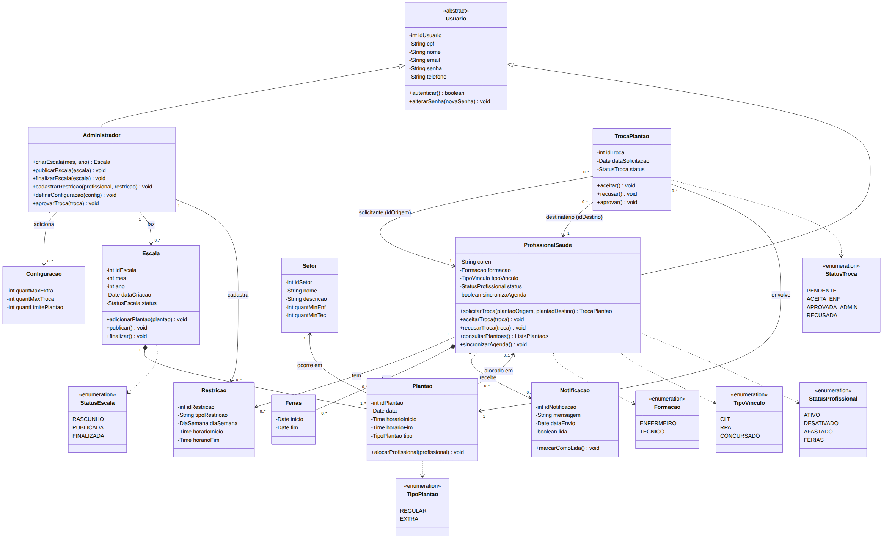

# NurseFlow - Diagrama de Classes

## Visão geral

O diagrama apresenta as principais classes persistidas pelo backend do NurseFlow e como elas se relacionam no MongoDB. O modelo contempla usuários e perfis, setores, configurações, restrições, escalas, plantões, alocações de profissionais, versões publicadas, auditoria, notificações e solicitações de troca.

O diagrama foi elaborado a partir dos schemas Mongoose implementados no backend. Assim, ele representa o modelo de dados da aplicação, e não uma hierarquia abstrata de objetos: quando uma classe possui um campo `ObjectId` que referencia outra, a relação está representada como associação, não como herança.

Também está disponível a [versão vetorial SVG](./diagrama_classes-nurseflow.svg), que pode ser ampliada sem perda de qualidade.

Para facilitar a leitura, foram omitidos os campos técnicos repetidos (`createdAt` e `updatedAt`). Campos flexíveis armazenados como objetos ou snapshots, como `validacao`, `geracao`, `detalhes` e `snapshot`, foram resumidos como `Object`.

## 1. Usuários e perfis

### `Usuario`

Armazena os dados comuns de identificação e autenticação. O documento inclui nome, e-mail, CPF, telefone opcional, senha e o tipo de usuário. Também concentra informações de segurança e preferências: senha temporária, recebimento de notificações de escala, tentativas falhas de login, bloqueio temporário, data do último login e dados de redefinição de senha.

O campo `tipoUsuario` diferencia os perfis de administrador e profissional da saúde. A senha é armazenada como hash e não deve ser exposta em respostas da API.

### `Administrador`

Representa o perfil de coordenação. Seu schema contém o campo obrigatório `usuarioId`, que referencia o documento `Usuario` com os dados de identificação e autenticação. O identificador do administrador é usado, por exemplo, pela escala e pela versão publicada para registrar quem criou ou publicou o registro.

### `Profissional`

Representa um enfermeiro ou técnico. Também referencia `Usuario` pelo campo obrigatório `usuarioId`; seus dados próprios incluem:

- `coren`, registro profissional;
- `formacao`, como enfermeiro ou técnico;
- `tipoVinculo`, como concursado, CLT ou RPA;
- `status`, que indica se está ativo, desativado, afastado ou de férias;
- `sincronizaAgenda`, preferência de sincronização com agenda externa;
- `desativadoEm`, data opcional de desativação.

Os dados pessoais e de acesso permanecem em `Usuario`, enquanto os dados profissionais ficam no documento `Profissional`. São dois documentos associados, não subclasses de uma classe base.

## 2. Setores, quantitativos e configurações

### `Setor`

Representa uma unidade hospitalar em que os plantões podem ocorrer. Possui nome, descrição opcional, estado ativo/inativo e a estrutura `turnos`, incorporada ao próprio documento.

`turnos` contém os quantitativos mínimos dos períodos diurno e noturno. Cada período é representado por `Quantitativo`, com as quantidades de enfermeiros e técnicos necessárias. `TurnosSetor` e `Quantitativo` são objetos incorporados: não têm coleção ou identificador próprios.

### `Configuracao`

Armazena as regras gerais de escala identificadas por uma `chave` única. Inclui limites de trocas, plantões extras e plantões, além dos limites específicos de extras para profissionais concursados e CLT. O campo `cargas` guarda, por tipo de vínculo, os parâmetros de plantões de 24 e 12 horas.

As configurações não são associadas a um administrador por um campo de referência no schema. O diagrama, portanto, apresenta `Configuracao` como configuração global do sistema.

## 3. Restrições e disponibilidade

### `Restricao`

Registra uma regra ou período relacionado à disponibilidade de um profissional. Cada restrição possui uma referência obrigatória a `Profissional`, um tipo, início e fim. Pode conter também um dia da semana e uma observação.

Os tipos previstos são:

- `indisponivel` e `disponivel`;
- `ferias` e `ausencia`;
- `vinculo_externo`.

O documento modela férias e ausências como tipos de restrição com intervalo de datas; não há uma classe persistida separada chamada `Ferias`. O período pode ser usado pelo sistema ao avaliar a disponibilidade do profissional e a cobertura dos plantões.

## 4. Escalas, plantões e alocações

### `Escala`

Representa a escala de um mês e ano. Cada documento referencia o `Administrador` responsável e mantém seu estado de elaboração e publicação, a revisão atual, a versão publicada, a data de criação e os dados opcionais de validação e geração.

O estado da escala pode ser `rascunho`, `em_revisao`, `validada`, `publicada` ou `finalizada`. Os dados de validação e geração são guardados como objetos flexíveis, para registrar informações que não correspondem a uma classe persistida independente no modelo atual.

### `Plantao`

Representa uma vaga de trabalho com setor, data, horário de início e fim, duração em horas e tipo (`regular` ou `extra`). O plantão referencia obrigatoriamente uma `Escala` e um `Setor`. Pode incluir um motivo de cobertura e uma observação.

O plantão descreve a vaga e seus horários. A associação aos profissionais que a ocupam é mantida separadamente em `PlantaoProfissional`.

### `PlantaoProfissional`

É a classe de associação entre `Plantao` e `Profissional`. Cada registro referencia um plantão e um profissional e armazena também a função exercida naquele plantão, se a pessoa está em posição de liderança e a origem da cobertura.

`origemCobertura` pode indicar cobertura regular, relacionada a uma restrição ou complementar. Como a alocação é um documento próprio, o modelo permite registrar profissionais relacionados a um plantão sem guardar uma lista de profissionais dentro do documento `Plantao`.

## 5. Publicação, histórico e notificações de escala

### `VersaoEscala`

Guarda uma versão publicada da escala. Referencia a `Escala` e o `Administrador` que publicou, registra número da versão, mês, ano e data da publicação, e mantém um `snapshot` com o conteúdo da escala naquele momento. O campo `pendenciasConfirmadas` indica se pendências foram confirmadas na publicação.

O snapshot preserva o retrato publicado mesmo quando a escala de trabalho continua sendo editada em revisões posteriores.

### `AuditoriaEscala`

Registra uma ação realizada sobre uma escala. Cada documento referencia a escala e o `Usuario` responsável, e informa a revisão, a ação e a data em que ocorreu. O campo opcional `detalhes` guarda informações adicionais da operação.

### `NotificacaoEscala`

Registra uma notificação associada a uma escala e a uma versão. Contém o usuário destinatário, uma chave do evento, título e mensagem. `lidaEm` indica quando a notificação foi lida; quando não há data, a notificação ainda não foi marcada como lida.

## 6. Solicitações de troca de plantão

### `SolicitacaoTroca`

Representa o fluxo de troca entre dois profissionais. A solicitação registra o mês e ano de referência, a data de criação e o estado atual. Mantém referências distintas para o profissional solicitante e para o profissional solicitado, além das referências aos dois documentos `PlantaoProfissional` envolvidos.

Os estados registrados no modelo são:

- `aguardando_resposta`;
- `aguardando_coordenacao`;
- `recusada_pelo_profissional`;
- `aprovada`;
- `recusada_pela_coordenacao`.

Os campos `aceite` e `decisaoCoordenacao` guardam, quando aplicável, os dados da resposta do profissional e da decisão da coordenação, incluindo usuário responsável, data e justificativa opcional. `chaveIdempotencia` é opcional e permite identificar operações repetidas.

### `AuditoriaTroca`

Registra a decisão tomada sobre uma solicitação de troca. Referencia `SolicitacaoTroca` e o `Usuario` responsável e armazena resultado, data da decisão, justificativa opcional, indicação de exceção ao limite, informações de vínculos e versões afetadas e um identificador da operação.

### `NotificacaoTroca`

Registra uma notificação ligada a uma solicitação de troca e ao usuário destinatário. Armazena uma chave do evento, título, mensagem e, opcionalmente, a data em que foi lida.

## 7. Relações apresentadas no diagrama

| Origem | Destino | Referência / relação |
|---|---|---|
| `Administrador` | `Usuario` | `usuarioId` associa o perfil aos dados de usuário. |
| `Profissional` | `Usuario` | `usuarioId` associa o perfil profissional aos dados de usuário. |
| `Escala` | `Administrador` | `administradorId` identifica o responsável pela escala. |
| `Plantao` | `Escala` | `escalaId` identifica a escala à qual a vaga pertence. |
| `Plantao` | `Setor` | `setorId` identifica o local do plantão. |
| `PlantaoProfissional` | `Plantao` | `plantaoId` associa uma alocação à vaga. |
| `PlantaoProfissional` | `Profissional` | `profissionalId` identifica quem ocupa a vaga. |
| `Restricao` | `Profissional` | `profissionalId` identifica a pessoa a que a regra se aplica. |
| `VersaoEscala` | `Escala` e `Administrador` | Identifica a escala versionada e quem a publicou. |
| `AuditoriaEscala` | `Escala` e `Usuario` | Identifica a escala alterada e quem realizou a ação. |
| `NotificacaoEscala` | `Escala` e `Usuario` | Identifica a escala relacionada e o destinatário. |
| `SolicitacaoTroca` | `Profissional` e `PlantaoProfissional` | Registra solicitante, destinatário e os dois vínculos envolvidos. |
| `AuditoriaTroca` | `SolicitacaoTroca` e `Usuario` | Identifica a solicitação decidida e quem registrou a decisão. |
| `NotificacaoTroca` | `SolicitacaoTroca` e `Usuario` | Identifica a solicitação relacionada e o destinatário. |

As linhas do desenho destacam associações principais para manter a leitura clara. Todos os campos de referência estão indicados também nos atributos das classes. Como os dados ficam no MongoDB, as referências são armazenadas como `ObjectId`; elas não representam herança e não implicam, por si só, exclusão em cascata. A quantidade de documentos associados depende dos dados gravados e das regras da aplicação.

## 8. Escopo e interpretação

O diagrama foca nas classes persistidas e nas referências declaradas nos schemas Mongoose. DTOs, controllers, serviços, enums e componentes da interface não são documentos de domínio e, por isso, não aparecem como classes independentes. Os valores fechados de status e tipo foram apresentados dentro das classes correspondentes para deixar o desenho mais compacto.

As classes `TurnosSetor` e `Quantitativo` aparecem como estruturas incorporadas em `Setor`. De modo semelhante, `aceite`, `decisaoCoordenacao`, snapshots, dados de validação e detalhes de auditoria aparecem como objetos, pois o schema os mantém dentro do documento pai.

As referências indicadas mostram a estrutura dos dados, mas não garantem sozinhas regras de exclusividade, integridade ou cardinalidade inversa. Essas regras dependem das validações e operações implementadas nos serviços.

## 9. Arquivos de origem

O diagrama foi conferido com os schemas do backend:

- `back-end/src/usuarios/schemas/usuario.schema.ts` e `administrador.schema.ts`;
- `back-end/src/profissionais/schemas/profissional.schema.ts`;
- `back-end/src/restricoes/restricao.schema.ts`;
- `back-end/src/setores/schemas/setor.schema.ts`;
- `back-end/src/configuracoes/configuracao.schema.ts`;
- `back-end/src/escalas/schemas.ts`, que contém os schemas de escala, plantão, alocação, versões, auditorias, notificações e trocas.
